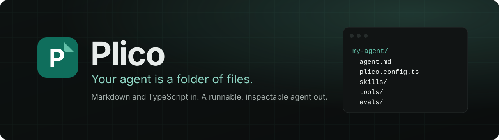
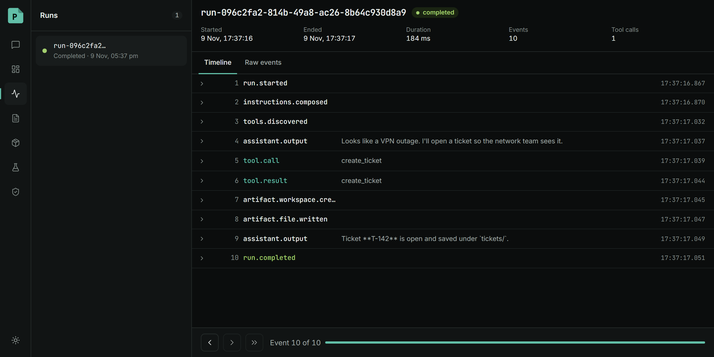
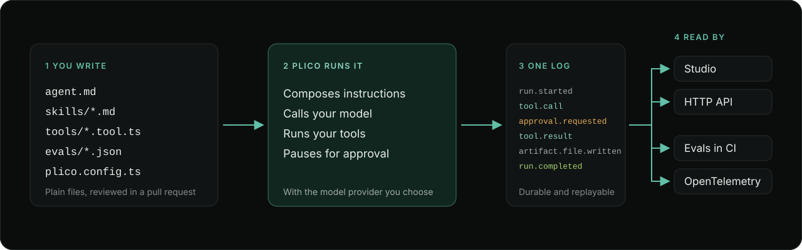

<div align="center">



**A TypeScript-first agent app kit.** Write instructions in Markdown and tools in TypeScript,
and get an agent you can run, inspect, approve and replay.

[](https://www.npmjs.com/package/@plico-ai/cli)
[](https://github.com/ITZSHOAIB/plico/actions/workflows/ci.yml)
[](LICENSE)
[](https://nodejs.org)

[Documentation](https://plico.sohab.dev/docs) ·
[Quickstart](https://plico.sohab.dev/docs/quickstart) ·
[Issues](https://github.com/ITZSHOAIB/plico/issues)

</div>

---

```sh
npm create plico@latest my-agent -- --provider anthropic
cd my-agent && npm install
npx plico run --dry .      # no API key needed
```

Add a key to `.env`, run `npm run dev`, and chat with your agent in Studio.

<p align="center">
  
</p>

Studio ships inside `@plico-ai/cli`. Every row above is one event from the run's log.

## How it works

<p align="center">
  
</p>

## What a project looks like

```text
my-agent/
├── agent.md            instructions, in Markdown
├── plico.config.ts     model, provider, settings
├── skills/             Markdown the agent loads when it needs it
├── tools/              TypeScript tools, with approvals
├── evals/              scripted cases that run in CI with no model
├── artifacts/          files the agent produces
└── memory/
```

Everything is a file you can read, review in a pull request, and commit next to your app code.

**Instructions** are plain Markdown:

```md
# Internal Ops Agent

You help the internal ops team triage requests.

- Use `create_ticket` to open a ticket.
- Use `close_ticket` only when the person asks. A person approves each call.
```

**Tools** are typed TypeScript. The handler's `input` is inferred from `inputSchema`:

```ts
import { defineTool } from "@plico-ai/sdk";

export default defineTool({
  name: "close_ticket",
  description: "Close a support ticket. This cannot be undone.",
  inputSchema: {
    type: "object",
    properties: { ticketId: { type: "string" } },
    required: ["ticketId"],
    additionalProperties: false,
  },
  capabilities: ["ticket:write"],
  approval: { required: true, reason: "Closing a ticket cannot be undone." },
  handler: async ({ ticketId }) => ({ ticketId, status: "closed" }),
});
```

When the model calls `close_ticket`, the run pauses and Studio asks a person to approve it.

## Why Plico

- **File-first.** The project is a directory tree. No hidden state, no code generation, no build step.
- **One event log.** Every run is a durable, replayable trace. Studio, evals, streaming and the HTTP API all read from it.
- **Human approval.** Mark a tool as needing approval and the run waits until someone decides.
- **Studio included.** Chat, inspect run events, review approvals, and diff the artifacts your agent writes.
- **Evals without a model.** Scripted cases replay in CI, so a change to a prompt or tool is checked in seconds.
- **Any provider.** Anthropic, OpenAI, Google, or any OpenAI-compatible endpoint (Ollama, OpenRouter, LiteLLM).
- **Embeds in your backend.** `createPlico` mounts the API in Express, Hono or Next.js, tags runs with your own metadata, and leaves authentication to your app.
- **OpenTelemetry tracing.** Export spans to the collector you already run.

## Packages

| Package | Purpose |
| --- | --- |
| [`create-plico`](packages/create-plico) | `npm create plico`: scaffold a project |
| [`@plico-ai/cli`](packages/cli) | The `plico` command: validate, run, serve, eval, readiness |
| [`@plico-ai/sdk`](packages/sdk) | `defineTool` and `defineConfig` for your project |
| [`@plico-ai/server`](packages/server) | The HTTP API and `createPlico` for embedding |
| [`@plico-ai/runtime`](packages/runtime) | The run loop and event store |
| [`@plico-ai/core`](packages/core) | Project loading and validation |
| [`@plico-ai/contracts`](packages/contracts) | Wire types |

## Status

Plico is a **developer preview (`0.1`)**. The HTTP API under `/v1` takes additive changes only; the TypeScript exports can change in any `0.x` minor release. It needs Node 22.18 or later. Follow the [milestones](https://github.com/ITZSHOAIB/plico/milestones) for what is planned.

## Learn more

- [Quickstart](https://plico.sohab.dev/docs/quickstart): scaffold, run, and approve a tool call
- [Project layout](https://plico.sohab.dev/docs/project-layout), [Tools](https://plico.sohab.dev/docs/tools), [Providers](https://plico.sohab.dev/docs/providers)
- [Approvals](https://plico.sohab.dev/docs/approvals), [Events](https://plico.sohab.dev/docs/events), [Upgrading](https://plico.sohab.dev/docs/upgrading), and [how Plico compares](https://plico.sohab.dev/docs/compare)
- [Embed in a backend](https://plico.sohab.dev/docs/backend) and the [HTTP API](https://plico.sohab.dev/docs/http-api)
- [`examples/internal-ops-agent`](examples/internal-ops-agent), a complete project

## Contributing

See [CONTRIBUTING.md](CONTRIBUTING.md) to set up the repository and run the checks.

## License

Apache-2.0. See [LICENSE](LICENSE) and [NOTICE](NOTICE).
